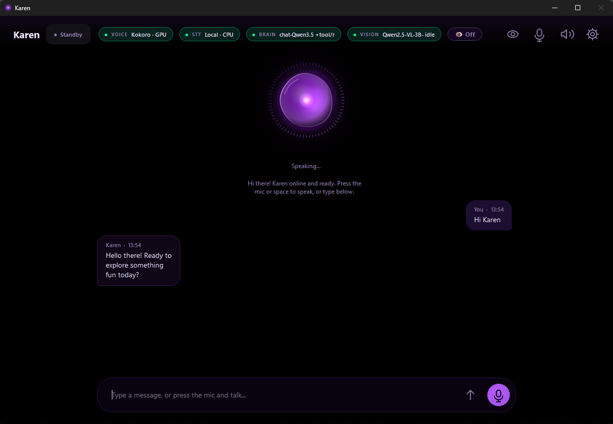

<div align="center">

# Karen Assistant

**A local-first Windows voice assistant that controls your PC — without the mouse.**

[](LICENSE)
[](pyproject.toml)
[](#requirements)
[](#)

[Why Karen?](#why-karen) · [Features](#features) · [Quick start](#quick-start) · [Commands](#what-you-can-say) · [Architecture](#how-it-works)

</div>

<p align="center">
  
</p>

---

## Why Karen?

Most desktop AI assistants are one of two things: a chatbot window that
can't touch your machine, or an automation script that can't think. Karen
is both — **she understands natural language and acts on it**, using real
UI controls instead of pixel coordinates.

Three things make her different from the pack:

**She never touches the mouse.** Every click is a real Windows UI
Automation control found by name or identifier. Every keystroke is a real
keyboard event. This makes her deterministic, testable, and impossible to
misclick — a huge deal if you've ever watched a GUI-automation tool
blindly click the wrong button because the layout shifted 3 pixels.

**She runs entirely on your machine.** Kokoro for speech, Whisper for
transcription, llama.cpp for reasoning — all offline. Optional cloud LLM
for hard turns, but never required. No telemetry, no data harvesting, no
"we've updated our privacy policy" emails.

**She answers in under 100 ms when she can.** A fast-path router catches
`type X`, `open Y`, `press ctrl+s`, `screenshot`, `mute`, `next track`,
`volume 50`, `lock screen` before any LLM is consulted. You get instant
response, zero token spend.

If you want a general-purpose chatbot, use ChatGPT. If you want an
assistant that *actually does things on your computer* without uploading
your screen to a server, Karen is for you.

---

## Features

| Feature | What it does |
|---|---|
| 🎙️ **Voice or text** | Kokoro TTS (offline) and faster-whisper STT (offline). Talk, type, or both. |
| 🧠 **Three brain modes** | **Cloud** (Groq / Cerebras / Gemini / OpenRouter / Mistral), **Local** (llama.cpp / Ollama / LM Studio), or **Hybrid** with automatic fallback. |
| 🖥️ **Real desktop control** | Opens apps and websites, clicks UI controls, types text, presses keys. Zero mouse movement. |
| 👁️ **Screen vision** | Qwen2.5-VL reads your screen to answer questions, summarize text, or name videos. |
| ⚡ **Fast-path commands** | `type hello`, `press ctrl+s`, `screenshot`, `mute`, `lock screen`, `next track`, `volume 50` — instant, no LLM turn. |
| ⏰ **Scheduled tasks** | *"remind me to stretch in 20 minutes"*, *"at 5pm open Spotify"*, *"every day at 9am take a screenshot"*. |
| 🎨 **OLED deep-black UI** | Dark purple theme, animated orb, live context panel, and a cheerful persona you can swap out. |
| 🔒 **No telemetry** | Nothing leaves your PC except to the LLM you configure, or to HuggingFace/GitHub for one-time model downloads. |

---

## Quick start

### 1. Install

```powershell
git clone https://github.com/ibra-Tuna/karen-assistant.git
cd karen-assistant

python -m venv .venv
.venv\Scripts\activate

pip install --upgrade pip
pip install -r requirements.txt
```

**GPU acceleration** (optional, recommended for local models):

```powershell
pip install onnxruntime-gpu
```

### 2. Launch

```powershell
python karen.py
```

The GUI opens. On first launch you'll see:

> *"Hi there! Karen online and ready."*
>
> *"No API key and no local model. Open Settings → AI."*

### 3. Configure your brain

Open **⚙ Settings** (top right) and pick one path:

<table>
<tr>
<td valign="top" width="33%">

**☁️ Cloud**

No GPU needed.
Free Groq tier is enough.

1. Settings → AI → Brain mode = **Cloud**
2. Paste a key from [console.groq.com/keys](https://console.groq.com/keys)
3. Settings → Models → download **Kokoro** (~340 MB)
4. Settings → Voice → **Test voice**

</td>
<td valign="top" width="33%">

**💻 Local**

Fully offline.
Needs 5+ GB VRAM.

1. Settings → AI → Brain mode = **Local**
2. Settings → Models → download **Chat**, **Tool**, **Router**
3. Settings → Models → download **Kokoro** and **Whisper**
4. Settings → Voice → **Test voice**

</td>
<td valign="top" width="33%">

**🔀 Hybrid**

Best of both.
Automatic fallback.

Both of the above.
Local for cheap turns,
cloud for hard ones.

Requires both a key
and a downloaded
local model.

</td>
</tr>
</table>

### 4. Talk

Press the mic button or the **space bar**. Say *"open notepad"*, or type
it in the box. Karen responds.

---

## What you can say

### ⚡ Instant commands

These fire in under 100 ms — no LLM turn, no token spend:

| Command | What happens |
|---|---|
| `hi` / `hello` | Karen greets you in her voice |
| `open notepad` | App launches (any app on your PC) |
| `open youtube.com` | Browser opens the site |
| `close notepad` | Notepad closes |
| `focus chrome` | Brings Chrome to the front |
| `google best pizza near me` | Searches Google in your browser |
| `type hello world` | Types into whatever has focus |
| `press ctrl+s` | Sends the key chord |
| `screenshot` | Captures the screen to `~/Pictures/Karen/` |
| `mute` / `unmute` | Toggles system mute |
| `volume 50` | Sets volume to 50% |
| `next track` / `previous track` | Skips media playback |
| `play` / `pause` | Toggles media |
| `lock the screen` | Locks Windows |

### 🧠 Agent commands

These take an LLM turn but handle multi-step or screen-reading tasks:

| Command | What happens |
|---|---|
| `what's on my screen` | Vision model describes the current window |
| `summarize this page` | Reads text and summarizes |
| `open notepad and type hello` | Launches, focuses, types — chained |
| `in notepad type hello into the text area` | Targets a specific field |
| `reply to that message yes` | Reads the conversation, types, sends |
| `open chrome and search for cats` | Multi-step with a browser |

### ⏰ Scheduled tasks

| Command | What happens |
|---|---|
| `remind me to drink water in 30 minutes` | Schedules a reminder |
| `at 5pm open spotify` | Schedules a launch |
| `every day at 9am take a screenshot` | Recurring task |
| `list my tasks` | Shows all scheduled tasks |
| `cancel all tasks` | Clears the schedule |

---

## How it works

```
User speaks or types
        │
        ▼
  ┌──────────────┐         ┌─────────────────┐
  │  karen.py    │ ──plan─→│  agent.py       │───tool call──┐
  │  (brain)     │←─result─│  (agent loop)   │              │
  └──────┬───────┘         └─────────────────┘              ▼
         │              Anti-loop:                  ┌───────────────┐
         │              · 2 identical calls block   │  toolkit.py   │
         │              · A→B→A→B stops             │  (68 tools)   │
         ▼              · 4 consecutive fails stop  └───────────────┘
  ┌──────────────┐
  │  Kokoro TTS  │  ← Response spoken back
  └──────────────┘
```

Four source files:

| File | Role |
|---|---|
| `karen.py` | GUI, voice pipeline, brain, config, model management |
| `agent.py` | Desktop agent — plans and executes tool calls step by step |
| `toolkit.py` | Tool surface — UIAutomation, files, shell, web, media, OCR, tasks |
| `tasks.py` | Scheduled task parser and scheduler |

### Why these design choices

- **No mouse, ever.** Every interaction is a real control (found by
  UIAutomation name or identifier) or a keyboard shortcut. Deterministic,
  testable, impossible to misclick.
- **Fast-path before LLM.** Common commands match a regex in `agent.py`
  and fire immediately — no LLM latency, no token spend.
- **Dual-vote routing.** The router model and the regex must both be wrong
  before a command lands in the wrong lane.
- **Anti-loop enforcement.** Two identical tool calls in a row block;
  four consecutive failures abort. No infinite retry spirals.
- **Console-free EXE.** `build.spec` produces a GUI-only binary with the
  Python runtime bundled in `_internal/`.
- **No telemetry, ever.** Config and memory live on your machine.
  Nothing is uploaded for training.

---

## Models used

All models are optional — download the ones you need through the GUI.

| Model | Size | Purpose |
|---|---|---|
| **Kokoro** | ~340 MB | Offline neural TTS — Karen's voice |
| **faster-whisper** (distil-large-v3) | ~1.5 GB | Offline speech recognition |
| **Chat LLM** (Qwen3.5-4B) | ~2.5 GB | Local reasoning |
| **Tool LLM** (LFM2.5-1.2B-Nova) | ~900 MB | Local function calling |
| **Router LLM** (LFM2.5-230M) | ~250 MB | Local intent classification |
| **Vision** (Qwen2.5-VL 3B) | ~2.5 GB | Screen understanding (optional) |

In **Cloud** and **Hybrid** modes, the local **tool** and **router** lanes
still run if configured — they classify intent and route function calls
before hitting the cloud. That saves tokens and latency on every action
command.

---

## Requirements

| | Minimum | Recommended |
|---|---|---|
| **OS** | Windows 10 (64-bit) | Windows 11 |
| **Python** | 3.10 | 3.12 |
| **RAM** | 8 GB | 16 GB |
| **GPU** | Any (CPU mode) | NVIDIA with 5+ GB VRAM |
| **Disk** | ~500 MB (source) | ~8 GB (with all models) |
| **Microphone** | Optional | Any USB or built-in |

**Python 3.13 is not yet supported** — `onnxruntime` wheels aren't published for it.

---

## Configuration

All settings live in `karen_config.json` next to the executable (or in
`%APPDATA%\Karen\` if the install folder is read-only). The app manages
this file — you rarely need to edit it by hand.

| Settings tab | What you'll find |
|---|---|
| **AI** | Brain mode, provider + key, local model path, local lanes, personality |
| **Voice** | Kokoro voice, pitch, effect, mic, Whisper device, speech detection |
| **PC control** | Enable PC control, screen reading, vision model, screen glance, agent behavior |
| **Tasks** | Scheduled task list, natural-language task input |
| **Models** | One-click downloads: Kokoro, Whisper, chat/tool/router, vision LLM |
| **Interface** | Theme, accent color, orb palette, animation toggle |

---

## Building an EXE

If you want a single-folder distribution that doesn't need Python:

```powershell
pip install pyinstaller
pyinstaller --clean --noconfirm build.spec
```

Produces `dist/Karen/Karen.exe` with **no console window**. Distribute
the entire `dist/Karen/` folder — the `_internal/` subfolder contains the
Python runtime and all native libraries.

On first launch, place your Kokoro models next to `Karen.exe`:

```powershell
Copy-Item kokoro-v1.0.onnx   dist\Karen\
Copy-Item voices-v1.0.bin    dist\Karen\
```

The rest (chat/tool/router models, Whisper, vision) can be downloaded
through the GUI on the target machine.

---

## Known limitations

- **Windows only.** The desktop control layer relies on Windows UI
  Automation. macOS and Linux are out of scope.
- **No mouse control by design.** If a target app has no accessible
  controls, the agent can't reach it. Prefer apps that expose UIAutomation
  names.
- **Local models need GPU.** A 4B chat model on CPU runs at ~1 token/s.
  A 6 GB GPU runs it at 30–60 tokens/s.
- **Vision is optional.** Downloading the vision model (~2.5 GB) is only
  needed if you want screen understanding.
- **Elevated windows.** Karen can't type into apps running as
  administrator unless Karen itself is launched as administrator.
- **No auto-update.** This is a source project. Pull to update.

---

## Getting help

- 🐛 **Found a bug?** Open an [issue](https://github.com/ibra-Tuna/karen-assistant/issues/new/choose) — the template walks you through what to include.
- 💬 **Question or setup help?** [Discussions](https://github.com/ibra-Tuna/karen-assistant/discussions) is the place.
- 🔒 **Security concern?** See [`SECURITY.md`](SECURITY.md) — never open a public issue for these.
- 📖 **Want to contribute?** Read [`CONTRIBUTING.md`](CONTRIBUTING.md) first.

---

## Credits

Karen stands on the shoulders of open-source work:

- [Kokoro](https://github.com/hexgrad/kokoro) — offline neural TTS
- [Kokoro-ONNX](https://github.com/thewh1teagle/kokoro-onnx) — ONNX runtime for Kokoro
- [faster-whisper](https://github.com/SYSTRAN/faster-whisper) — offline speech recognition
- [llama-cpp-python](https://github.com/abetlen/llama-cpp-python) — local GGUF inference
- [PySide6](https://pypi.org/project/PySide6/) — cross-platform Qt bindings
- [uiautomation](https://github.com/yinkaisheng/Python-UIAutomation-for-Windows) — Windows UIAutomation bindings
- [Qwen 2.5](https://huggingface.co/Qwen) — chat and vision models
- [LFM 2.5](https://huggingface.co/LiquidAI) — router and tool-calling models

Each dependency retains its own license.

---

## License

MIT — see [`LICENSE`](LICENSE). Free to use, modify, and redistribute.
